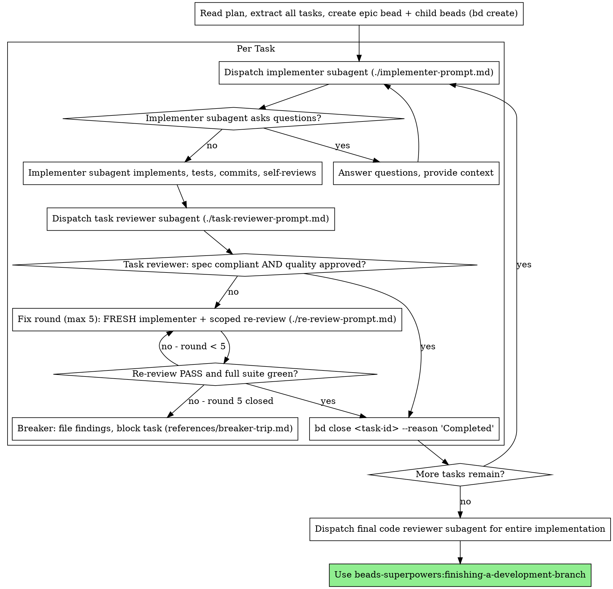

# Subagent-Driven Development

Execute plan by dispatching fresh subagent per task, with a single read-only task review after each — one reviewer returns a spec-compliance verdict and a code-quality verdict in one pass.

**Why subagents:** You delegate tasks to specialized agents with isolated context. By precisely crafting their instructions and context, you ensure they stay focused and succeed at their task. They should never inherit your session's context or history — you construct exactly what they need. This also preserves your own context for coordination work.

**Core principle:** Fresh subagent per task + a single read-only task review (spec + quality verdicts in one pass) = high quality, fast iteration

**Continuous execution:** Do not pause to check in with your human partner between tasks. Execute all tasks from the plan without stopping. The only reasons to stop are: BLOCKED status you cannot resolve, ambiguity that genuinely prevents progress, or all tasks complete. "Should I continue?" prompts and progress summaries waste their time — they asked you to execute the plan, so execute it.

## Rulings and Escalation

**You MAY rule when the spec unambiguously settles it. Everything else escalates.** Ruling from the
spec is *reading the binding authority*, not descoping; deciding a requirement is not worth meeting
stays your human partner's call. Enumerated may-rule / must-stop lists:
[references/rulings-and-escalation.md](references/rulings-and-escalation.md) — read it the first time
a conflict surfaces. **Precedence: must-stop wins** where both could apply, and **a security finding
is NEVER rulable and never parkable**, whatever the plan or spec says (`references/breaker-trip.md`).

**Every ruling cites its authority** — `Ruling: <what you decided> — settled by <spec §/heading> —
<what it costs if wrong>`. No citable spec location means it is **by definition not spec-settled**:
escalate. Fill-or-fail, not a judgment call.

## When to Use

Use when you have an implementation plan whose tasks are mostly independent and your human partner did not choose inline execution. Inline chosen, or no subagent tool → beads-superpowers:executing-plans; no plan, or tightly coupled tasks → brainstorm or execute manually.

**Read `references/when-to-use.md` (in this skill's directory) before choosing a mode** — the decision graph and its costs.

## Pre-Flight Plan Review

**Read `references/preflight.md` (in this skill's directory) before Task 1** — ask about unsettled conflicts once, up front.

## The Process (Sequential Mode)

> This section describes **sequential execution** — one task at a time in a shared epic worktree. This is the default when tasks have dependencies or only one task is unblocked. For parallel execution of independent tasks, see **Parallel Batch Mode** below.



**Checking for remaining tasks:** Use `bd ready --parent <epic-id>` to see remaining unblocked child tasks. For a per-epic view use `bd list --parent <epic-id> --status open,in_progress,blocked,deferred` (`bd epic status` takes no id and reports every epic). When `bd ready` returns no results for the epic, all tasks are complete.

> **`--claim` consent boundary.** This skill's autonomous take-next / batch-dispatch flow is the one place `bd ready --claim` is legitimate. That autonomous `--claim` is FORBIDDEN wherever the user picks the work (orientation, brainstorming, session close) — the consent gate binds even when this skill is not loaded.

> **Leases (bd v1.3.1).** A claim carries a lease (default 5 minutes) that expires unless heartbeated. As the plan's bead owner, run `bd heartbeat <id>` on every in-flight bead each time you regain control: after each subagent return, or at each task boundary when executing inline. If the heartbeat fails, the claim was reclaimed: stop and check `bd show <id>` before you commit, close or re-claim anything. **Never** `bd reclaim`, `bd unclaim --force`, or `bd update --force` another actor's claim without your human partner's consent.

## Parallel Batch Mode

**Read `references/batching.md` (in this skill's directory) before a parallel batch** — one `bd worktree` per task, max 5.

When a parallel task fails review: **Do not merge** its task branch into the epic branch.

## Model Selection

Use the least powerful model that can handle each role to conserve cost and increase speed.

**Always specify the model explicitly when dispatching a subagent.** An omitted model inherits your session's model — often the most expensive — which silently defeats this section. Where your harness has a separate reasoning-effort setting, set it in the same call: model alone can reset effort to that model's default. **Batching and waiting:** several small same-shape tasks go in ONE dispatch, not one each, and never poll a wait interface with short timeouts — see [references/dispatch-efficiency.md](references/dispatch-efficiency.md).

**Mechanical implementation tasks** (isolated functions, clear specs, 1-2 files): use a fast, cheap model. Most implementation tasks are mechanical when the plan is well-specified.

**Integration and judgment tasks** (multi-file coordination, pattern matching, debugging): use a standard model.

**Architecture and design tasks**: use the most capable available model.

**Review tasks (task review, re-review, final review) default to the most capable tier** — that default is not a cost target to negotiate down. The one narrow exception: reviewing a genuinely small, mechanical diff (1-2 files, low complexity and risk, no design judgment) may use the standard tier — the scaling is by diff size, never by convenience or to cut cost (Production-Grade Doctrine).

**Fix-loop escalation:** when a fix round's re-review still leaves findings open, escalate the next round's implementer to a more capable tier before you simply run another round at the same tier — an extra round costs more turns than a tier bump costs tokens.

**Task complexity signals:**
- Touches 1-2 files with a complete spec → cheap model
- Touches multiple files with integration concerns → standard model
- Requires design judgment or broad codebase understanding → most capable model

**Delegated orchestration (opt-in, whole plan only):** where the harness nests subagents, your human partner may opt in — per run, never assumed — to one orchestrator subagent running this skill end to end and owning the plan's beads until it returns; the session touches none of them meanwhile, relays its "Rulings I made" verbatim, and verifies the ledger against `git log` before any merge — `../using-superpowers/references/claude-code-tools.md`.

## Handling Reviewer ⚠️ Items

The task reviewer returns a Spec Compliance verdict of ✅, ❌, or ⚠️. A ⚠️ "cannot verify from diff" item does **not** block the task on its own — but you (the controller) must resolve it, because it usually needs cross-task context the reviewer lacks. Check the named requirement against the broader implementation. If the ⚠️ turns out to be a real gap, treat it as a failed spec review and re-dispatch the implementer to close it; if it's actually satisfied elsewhere, record that and proceed.

## Fix Rounds

A review returning findings starts a fix round: dispatch a **fresh implementer**
(never resume) with the task brief, the current findings, and only the **most
recent** section of the report file. **Record `ROUND0_HEAD` (round 0's final
commit, not `BASE`) before dispatching fix round 1** — it is round 1's `<fix-base>`.
Then dispatch a scoped re-review filling `re-review-prompt.md` against
`bash scripts/review-package <plan-file> <fix-base> HEAD`.

**A re-review PASS requires the reviewer's verdict AND a green full test suite** — **you (the controller) run the suite** and report it in `[SUITE_STATUS]`. What the scoped reviewer cannot see, and why, is in `references/breaker-trip.md`.

**Completion criterion:** re-review returns PASS with a green suite, or the round counter increments.

## The Breaker

The fix loop runs at most **five rounds**. If round five closes with findings still
open, the breaker trips — follow `references/breaker-trip.md`.

**Completion criterion:** every open finding has a bead ID, the task bead is
`blocked`, and the round history is surfaced to the user.

Implementer status handling (BLOCKED / NEEDS_CONTEXT and friends): see `references/breaker-trip.md`.

> **Blocker-bead stamp:** `bd create "[spec] <title>" -t task --parent <epic-id> --notes "Severity:/Confidence:/Evidence:"` — see `verification-before-completion` → Agent-Filed Bead Discipline.

## Final Review

**Read `references/final-review.md` (in this skill's directory) before the final review** — delete nothing until outcomes are in beads and every ledger `Ruling:` is in "Rulings I made".

## File Handoffs

**Read `references/handoffs.md` (in this skill's directory) before dispatching** — hand over files; dispatch as `general-purpose`.

## Example Workflow

**Read `references/example-workflow.md` (in this skill's directory) before a first run** — one plan, end to end.

## Durable Progress

Conversation memory does not survive compaction, and a controller that loses its place can re-dispatch completed tasks. **Beads is your durable ledger** — it survives compaction and is reloaded by the session hook's composed beads context (or `bd prime` if that context is missing). After any interruption, run `bd ready --parent <epic-id>`: tasks still open are the remaining work; closed task beads are done — do not re-dispatch them. Record each task's commit range in its close reason so `git log` recovery works without a separate file, e.g. `bd close <task-id> --reason "Completed: commits <base7>..<head7>, review clean"`. Do **not** keep a separate markdown progress ledger — the beads DB is the single source of truth.

**Capture what you learned.** At close, record durable, evidence-backed insights (still true next month, tied to a file, test, or command). Never record guesses, one-offs, or secrets (tokens, keys, PII — every memory is injected into all future sessions). Update in place (`bd remember --key <key>`) rather than adding a near-duplicate.

```bash
bd remember "<kind>: <durable, evidence-backed insight>"   # kind: lesson / pattern / design / root-cause / research
```

## Red Flags

| Rationalization | Reality |
|---|---|
| "It's a small change, I'll just start on main" | Never start implementation on main/master branch without your human partner's explicit consent — no exception for size. |
| "The task review is basically a formality here" | Never skip the task review, and never accept a report missing either verdict — spec-compliance AND code-quality are both required. |
| "Good enough, I'll move on" | Never proceed with unfixed issues. |
| "Parallel subagents on different files won't collide" | Every parallel subagent MUST have its own `bd worktree` — never dispatch parallel subagents without per-task worktree isolation. |
| "A few extra subagents this batch won't hurt" | Never dispatch more than 5 parallel subagents in a single batch (resource exhaustion). |
| "Claude's built-in `isolation: \"worktree\"` is the same thing" | It bypasses beads DB sharing — `bd worktree` is not optional isolation, it's the only isolation this skill recognizes. **Never** substitute Claude's `isolation: "worktree"` parameter for it. |
| "The subagent can just read the plan file itself" | Never make a subagent navigate the raw multi-task plan file — give it a focused, self-contained task brief instead (`bash scripts/task-brief` writes one, see File Handoffs). |
| "It'll figure out where the task fits" | Never skip scene-setting context — the subagent needs to understand where its task fits. |
| "Ignore subagent questions, keep it moving" | Answer clearly and completely, provide additional context if needed, and don't rush the subagent into implementation. |
| "Close enough on spec compliance" / "Accept 'close enough' on spec compliance" | Reviewer found spec issues = not done. Fix it, or run out the five-round cap and let the breaker take over (`references/breaker-trip.md`) — those are the only exits. |
| "Skip review loops (reviewer found issues = implementer fixes = review again)" / "The fix was small, skip the re-review" / "Don't skip the re-review" | Unreviewed fixes are how regressions land. Every fix round ends with a scoped re-review — no exception for a small diff. |
| "Let implementer self-review replace the task review" | Both are needed — self-review never substitutes for the task review. |
| "One more task while this review sits open won't hurt" | Never move to the next task while the review has open issues. |
| "Coach a reviewer to suppress findings" | Never instruct a reviewer to ignore or not flag an issue, or pre-rate a finding's severity. If your reviewer prompt contains "do not flag", "don't treat X as a defect", "at most Minor", or "the plan chose", stop: you are pre-judging. Let the reviewer raise it and adjudicate in the review loop. |
| "I'll fix it myself, dispatching is overhead" / "Don't try to fix manually (context pollution)" | Controller fixes pollute your context and skip review. Dispatch a fresh implementer through the fix loop with the specific findings instead — never resume, never fix it yourself. |
| "One more round will converge" / "Just one more fix round, it's nearly there" | Past the cap, rounds don't converge — the loop is capped at five rounds. At the cap, file the findings and surface them to the user (`references/breaker-trip.md`). |
| "The reviewer will just find something new anyway" | A scoped re-review verifies only the named findings in the fix diff; it cannot wander. New findings on code the fix diff didn't touch aren't this round's job — track them separately, they don't extend the loop. |
| "This finding is obviously wrong, I'll drop it" | Never self-adjudicate a finding. At the round cap, file every open finding as a bead and surface both dispositions to the user — silent discards are forbidden. |
| "The spec probably implies it" / "the spec would obviously want this" | Not spec-settled. You may rule only when you can cite the spec location that settles it; "probably implies" is the sound of a judgment call wearing the spec's authority. Unclear means escalate. |
| "It's spec-settled, so I don't need to write the ruling down" | An unrecorded ruling is indistinguishable from a silent descope. Ledger it in the `Ruling: … — settled by … — …` form or you did not rule, you just decided. |
| "The implementer spawned its own reviewer — free extra assurance" | It's a duplicate seat reviewing the same diff; the task review is the gate. A worker-spawned reviewer is a defect to flag, not rigor. |
| "Reviews slow the loop down" | The loop without reviews is just unverified churn — reviews are the loop's brakes and steering. |
| "Recording progress in beads is overhead" | Beads is what survives compaction. Controllers that lose their place have re-dispatched entire completed task sequences — record each task's commit range in `bd close --reason` as you go. |
| "Discard or defer a failed task to quietly descope a required deliverable" / "let Model-Selection cost-minimization accept weaker correctness/security review" | Surface the trade-off, never take it silently (Production-Grade Doctrine). |

## Integration

**Read `references/integration.md` (in this skill's directory) before handing off** — required and paired skills.
