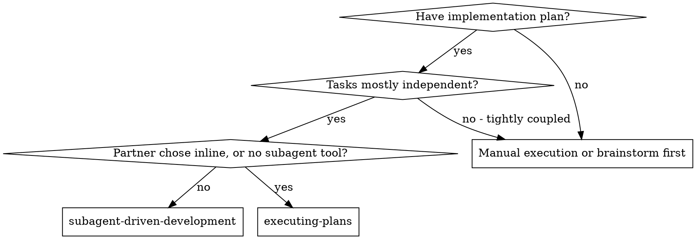

# When to Use

Read this when you are deciding between this skill, executing-plans, and brainstorming first.

**vs. Executing Plans (inline):**
- Fresh subagent per task (no context pollution) instead of one context doing every task
- Review after each task (spec compliance + code quality) instead of only at the end
- Costs a fresh context per task and per review; inline costs one context plus one final reviewer
- Both run in this session, share the same plan workspace under `.internal/sdd/`, use beads as the ledger, and never pause between tasks
