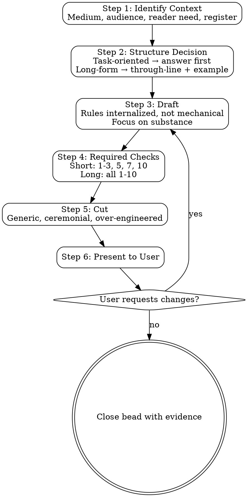

# Write Documentation

<!-- Adapted from Anbeeld/WRITING.md v1.3.1 (MIT). Attribution: README "Built on"; version pin: CLAUDE.md Upstream Sources. -->

**Announce at start:** "I'm using the write-documentation skill to write human-quality prose."

## Purpose

Write for the actual context.

The goal is prose that fits the medium, the task, and the reader. If it does that well, it will usually read as human-authored as a side effect. Do not optimize for "sounding human." Do not optimize for beating detectors. Both produce worse writing.

## When to Use

- Writing or substantially rewriting any human-facing text
- Creating documentation from scratch (README, guides, tutorials, API docs)
- Drafting blog posts, articles, emails, or Slack messages
- Rewriting a section flagged by `document-release` as needing major revision
- User asks for help with prose quality, tone, or style
- Writing PR descriptions, release notes, or CHANGELOG entries

## When NOT to Use

- Code comments and docstrings (for developers reading code)
- Commit messages (their own conventions)
- Agent prompts, skill files, CLAUDE.md (for AI agents, not human readers)
- Minor edits: fixing a typo, updating a version number, adding a link
- `document-release` work that is factual syncing, not prose rewriting

## Beads Integration

```bash
bd create "Write: <description of what's being written>" -t task
```

Closed with evidence at Step 6 — the single source of truth for the close command.

## Core Workflow



### Step 1: Identify Context

Before writing anything, answer these four questions:

1. **What is this text?** (medium: README, email, blog post, Slack message, guide, PR description...)
2. **Who reads it?** (developers, end users, managers, the public...)
3. **What do they need?** (an answer, a next action, understanding, a decision...)
4. **What register?** (formal technical docs, casual chat, professional email, marketing...)

Done when: all four questions have explicit answers.

### Step 2: Structure Decision

- **Task-oriented text:** Identify the answer or next action that belongs first.
- **Long-form text:** Decide the through-line and one concrete example, moment, or case that can carry real weight in the piece.
- Apply medium routing (see below).

Done when: the answer/next-action (task-oriented) or through-line-plus-example (long-form) is decided, and medium routing is applied.

### Step 3: Draft

Draft to fit the identified context, not an abstract idea of "good writing." The core rules below should be internalized during drafting, not mechanically applied paragraph by paragraph. Focus on substance over style.

Done when: a complete draft exists covering the identified context.

### Step 4: Required Checks

**Read `references/required-checks.md` (in this skill's directory) before the revision checks** — run the checks scaled to the piece and never output the audit unless asked.

Done when: the scaled check set has been run and every issue it found is fixed inline.

### Step 5: Cut

Cut what sounds generic, ceremonial, over-engineered, suspiciously over-specific, or too cleanly modular. Collapse paragraphs that restate each other. Replace the most generic clause in the piece with something specific or delete it.

Done when: the piece has been reviewed for generic/ceremonial language and the most generic clause is fixed or gone.

### Step 6: Present to User

Show the final text. If the user requests changes, loop back to Step 3. When approved, close the bead: `bd close <id> --reason "Written: <what>, checks run: <which checks passed>"`.

Done when: the user has approved the text and the bead is closed with evidence of which checks ran.

## Precedence

**Read `references/precedence.md` (in this skill's directory) before resolving a rule conflict** — truth and safety beat user instructions, then genre, rules, watchlists.

## Medium Routing

**Read `references/medium-routing.md` (in this skill's directory) before choosing a format** — format follows the medium.

## Safety Rails

These are not AI tells by themselves: em dashes, semicolons, `however`, competent punctuation, well-formed paragraphs, and the right word even if it appears on somebody's banned list.

Do not invent typos. Do not break grammar on purpose. Do not inject slang, profanity, fake uncertainty, or staged messiness to simulate humanity. No mandatory `actually` turn. No manufactured negativity. No programmatic sentence-length wobble. Natural variety comes from the relationship between thoughts, not from alternating sentence lengths by formula.

Do not make text less usable or less accessible in the name of sounding less AI-written. Removing needed headings, lists, descriptive links, citations, caveats, or next steps is not a style improvement.

The recurring problem is regularity and mismatch, not any one feature. Use em dashes where they belong; do not reach for them as a default connective. If you keep using the same punctuation move in the same role, vary it rather than banning it. In casual internet prose, paragraph-after-paragraph em dashes are now a socially recognized AI cue, so prefer commas, colons, conjunctions, subordinate clauses, or full stops unless the dash clearly earns its keep. A full stop is not the automatic replacement; sometimes the fix is to make the relationship between the clauses clearer. For temporary compound modifiers, hyphenate before the noun and usually open after it; do not let the model turn every compound into a hyphenated unit.

## Core Rules

### 1. Anchor to the actual context before drafting

Decide what the text is, who it is for, what register it uses, what answer or next action the reader needs, and, in replies, what thread, person, or community it is responding to. A reply that could be pasted into any thread on the same topic will often read generic even if the prose is clean. Keep register stable across the piece.

### 2. Fit the format to the medium

Format is part of register. Over-structuring casual writing makes it feel templated. Under-structuring technical writing makes it harder to use. Match the format to the medium instead of obeying a global ban on bullets, headers, or emphasis.

### 3. Prefer concrete specificity over polished generality

Each substantial paragraph should carry at least one concrete anchor.

What counts:
- a proper noun the reader could look up
- a specific number that is not only a date or version
- a direct quote
- a named decision, moment, or thread
- a checkable detail
- in criticism, reporting, and reviews: a user-facing or otherwise observed detail of what changed in practice

What does not count:
- `many`, `various`, `several`, `a lot of`
- `in ways that mattered`, `meaningful changes`, `broad implications`
- `the standard X arc`, `the usual pattern`, `as is often the case`
- vague intensifiers in place of claims: `essentially`, `fundamentally`, `ultimately`
- milestone names, dates, titles, or feature labels standing alone with no material consequence attached

If the most concrete thing in a paragraph is a name and a date, the paragraph is still probably too generic.

### 4. Specificity must be earned

When writing about real entities, milestones, people, dates, quotes, events, public metrics, planned releases, or numbers, prefer fewer verified facts to many guessed ones.

Do not use specificity theater: invented milestone names, suspiciously exact claims, synthetic quotes, or decorative factuality added only to avoid sounding generic.

Be especially careful with hidden-mechanism claims: internal logic, unseen motives, back-end behavior, or claims about what a system is "really" doing under the hood. If the reader could not observe it and you cannot verify it, do not narrate it as fact.

Do not launder analysis through vague authority. Avoid `experts say`, `observers note`, `research suggests`, or `critics argue` unless you can name the source, describe what it actually supports, and keep your claim within that support.

Treat exact quotes, close paraphrases, public metrics, future claims, and causal claims as high-fragility facts. If you write that a person said something, a metric moved, a release is planned, or one change caused another, you need source support for that exact claim. If the support is weaker, narrow the claim: `coincided with`, `appeared alongside`, `was followed by`, or cut the relationship entirely.

If you cannot verify a claim, attribute it, soften it, or cut it.

### 5. Use plain words. Allow ordinary repetition. Prefer verbs.

Do not chase synonyms for basic words like `problem`, `change`, `system`, `work`, or `people`. Repeat the ordinary word when it is the right word. Prefer `we changed it` to `the implementation of the change`, `latency dropped` to `a reduction in latency was observed`, and `applying the rule` to `the application of the rule`. Prefer actions happening to people over abstractions being observed by systems.

### 6. Cohere through reference and sentence shape

Use pronouns and continued reference when the reader can easily track them. Do not restate the full frame in every paragraph. Treat signpost openers like `Furthermore`, `Moreover`, `Additionally`, `Importantly`, and `Notably` as things to justify, not default sentence starters.

Let closely related thoughts share a sentence when the relationship is tight. Use coordination for equal-weight thoughts (`and`, `but`, `so`), subordination for unequal ones (`because`, `although`, `when`, `if`, `which`, `that`), and colons or semicolons when the second clause explains, sharpens, or turns the first. A period should mark a real pause, shift, or emphasis, not merely the place where an adjacent thought happened to arrive.

Do not turn every idea into its own sentence for crispness. Short sentences are useful when the break creates emphasis, gives the reader time, or marks a real turn; they become false crispness when neighboring sentences are only separated because the prose is afraid to keep moving.

### 7. Do not perform

Avoid keynote cadence, mission-statement phrasing, applause-line endings, and ceremonial wrap-ups. Also avoid service-desk tone: no `Great question`, `Absolutely`, or similar canned praise unless the situation clearly calls for it; no `I hope this helps`, `Feel free to reach out`, or similar canned closers unless the situation clearly calls for it. Start where the answer starts. Stop where the answer stops.

### 8. Calibrate confidence, stance, and voice to genre

Be confident where evidence is strong. Be explicit where it is weak or interpretive. If the genre normally carries a visible writer (review, opinion, comment reply, personal post), let the writer appear. If the genre normally aims at neutrality (summary, documentation, news-style reporting), do not inject first person or attitude just to make the piece feel human. If the subject naturally invites a view, do not sand everything down to evenly polite neutrality. If the subject does not require a view, do not manufacture one. For public, technical, product, or instructional writing, keep language globally legible and inclusive.

### 9. Show concrete things before generalizing

Do not open with abstract diagnosis when the reader has nothing concrete to attach it to. This is not a ban on leading with the conclusion in web, docs, email, news, or task-oriented writing; if you lead with the conclusion, make it concrete enough to be useful. Usually the order should be:
1. what happened
2. where the pattern appeared
3. what constraint mattered
4. what failed or changed
5. what that seems to mean

### 10. Watch regularity

LLM writing often becomes suspicious when its most visible feature is its own regularity.

Watch for repeated use of the same moves:
- parallel enumeration and reflexive three-part cadence inside sentences
- multiple sentences doing hidden list work even without bullets
- concession-plus-positive rhythm (`not X, but Y`; `may sound X, but Y`)
- paragraph-closing type definitions (`the kind of X where Y`)
- identical paragraph arcs
- one neat claim sentence at the top of every paragraph followed by orderly elaboration
- the same punctuation move in every paragraph
- the same controlling metaphor or contrast returning until it feels too tidy
- repeated thesis-like openings
- stacked mini-sentences for impact, especially when each sentence carries one adjacent thought that could have shared a sentence

Three-item parallel lists still count. The fix is not random variation; it is to break the repeated pattern where it starts to dominate.

One common over-correction is false crispness: splitting every clause into its own sentence to break regularity. For when to combine and when to keep the split, see rule 6.

### 11. Let the thought develop

Longer pieces should not feel pre-solved. If the prose moves in a perfectly efficient straight line from claim to conclusion, it can feel rushed. Let the thought develop through a concrete example, a noticed detail, a sentence that gathers related material, or a brief doubling-back when the material naturally allows it.

Development can happen inside a sentence, not only across paragraphs. A cumulative sentence can start with the main claim and then add the reason, qualification, or consequence that belongs with it. Do not split that movement into separate sentences unless the break itself does useful work.

### 12. Choose structure consciously for longer pieces

Default genre shapes are not wrong. They are only a problem when used by reflex.

For task pages, procedures, reference docs, and news briefs, the predictable structure is often the clearest one. Do not avoid it for novelty.

For retrospectives, criticism, feature writing, and other developmental pieces, the obvious defaults are often weak:
- starting state -> changes -> verdict
- one topic bucket per paragraph
- one paragraph per named milestone

Choose a through-line instead: one constraint that started biting, one shift in what people actually had to do, one mismatch between promise and reality.

Useful alternatives: thematic instead of chronological, reverse-chronological, perspective-led, counterfactual, opinion-first, single-example-led.

### 13. Do not turn a piece into catalog prose or system-tour prose

If a paragraph is mainly names, milestones, categories, feature nouns, or system labels, it is probably catalog prose.

If each paragraph can be summarized with a single label such as `background`, `mechanism`, `impact`, `response`, `ending`, the piece is probably system-tour prose.

Do not give one paragraph to each milestone or one paragraph to each topic bucket unless that mapping is the actual point. Pick one change and trace its consequence. Cross-wire the piece so paragraphs depend on each other instead of sitting like labeled boxes.

### 14. Revise by reading and cutting

Re-read as a first-time reader. Cut anything that is auditioning. Cut sentences whose only job is to announce the next sentence. Collapse paragraphs that restate each other. Replace the most generic clause in the piece with something specific or delete it. Most edits should make the text shorter, but do not confuse concision with chopping: combining two tightly related sentences can be the cleaner edit when it restores the relationship between the thoughts.

## Optional Long-Form Diagnostics

Ten fallback heuristics for when the Required Checks aren't enough for a longer piece — not targets to optimize for. See [references/long-form-diagnostics.md](references/long-form-diagnostics.md).

## Examples of Useful Corrections

**Read `references/corrections-examples.md` (in this skill's directory) before rewriting a passage** — worked avoid/prefer pairs.

## Audit Watchlist

**Read `references/audit-watchlist.md` (in this skill's directory) before scanning a draft** — it flags repeated fallback, so never run it as find-and-replace.

## Red Flags / Anti-Rationalization

| Thought | Reality |
|---------|---------|
| "The rules will make my writing worse" | The rules target LLM defaults. If you are writing well already, they will not change much. |
| "I'll skip the checks -- the draft is good enough" | The checks catch regularity and genericity you cannot see while drafting. Run them. |
| "Technical docs don't need prose quality" | Technical docs are the most-read prose in most organizations. Bad docs cost more than bad blog posts. |
| "I'll just run the watchlist as a find-and-replace" | The watchlist targets repeated fallback, not individual words. `robust` is fine once; `robust` in every paragraph is the problem. |
| "Sounding human means adding typos and slang" | Sounding human means fitting the context. Fake humanity is worse than default LLM prose. |
| "I'll strip all structure to avoid looking AI-generated" | Removing needed headings and lists from technical writing is not a style improvement. |
| "This piece is too short for checks" | Short pieces still run checks 1-3, 5, 7, and 10. The bar is lower, not absent. |

**Capture what you learned.** At close, record durable, evidence-backed insights (still true next month, tied to a file, test, or command). Never record guesses, one-offs, or secrets (tokens, keys, PII — every memory is injected into all future sessions). Update in place (`bd remember --key <key>`) rather than adding a near-duplicate.

```bash
bd remember "<kind>: <durable, evidence-backed insight>"   # kind: lesson / pattern / design / root-cause / research
```

## Integration

**Read `references/integration.md` (in this skill's directory) before consulting the skill pairings** — pairs with document-release, which syncs docs to code after shipping.

